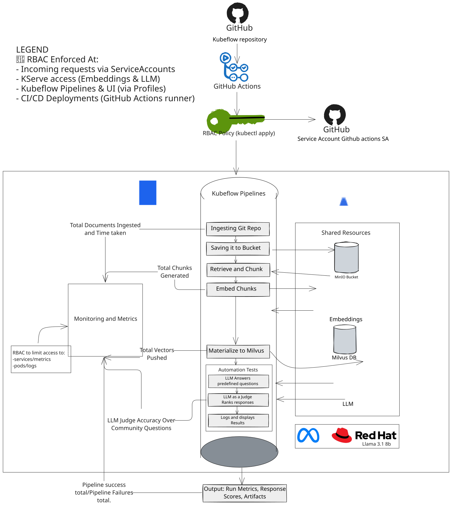
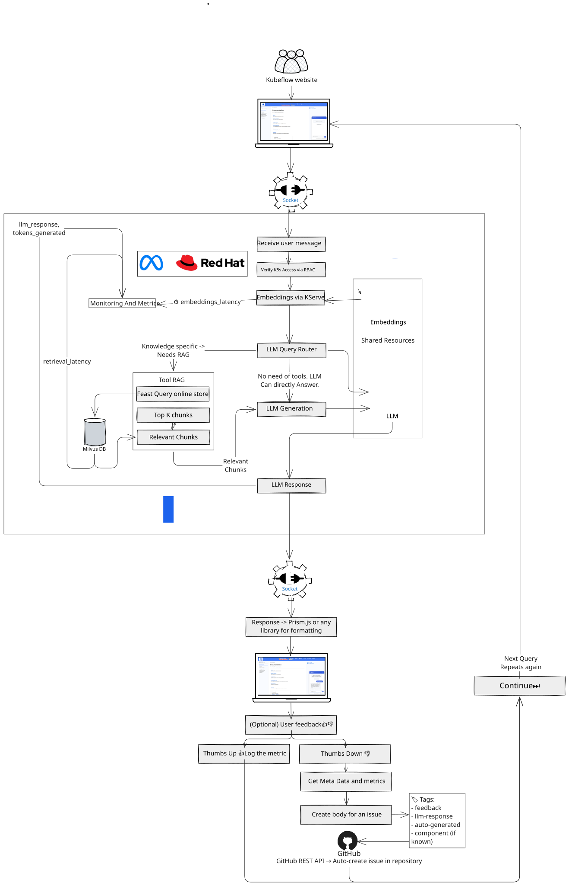

# Kubeflow Documentation AI Assistant

**Author**: Santhosh Toorpu

[](https://github.com/kubeflow/community/issues/867)
[](https://opensource.org/licenses/Apache-2.0)
[](https://www.python.org/downloads/release/python-3110/)
[](https://milvus.io/)
[](https://www.kubeflow.org/docs/components/pipelines/v2/)

The official LLM implementation of the Kubeflow Documentation Assistant powered by Retrieval-Augmented Generation (RAG). This repository provides a comprehensive solution for Kubeflow users to search across documentation and get accurate, contextual answers to their queries.

Built with modern infrastructure, the system leverages **Model Context Protocol (MCP)**, **Kagent**, and **Text Embeddings Inference (TEI)** to deliver a production-ready assistant.

## Table of Contents

- [Overview](#overview)
- [Architecture & Design](#architecture--design)
- [Repository layout](#repository-layout)
- [Prerequisites](#prerequisites)
- [Installation & Deployment](#installation--deployment)
- [API Server & Usage](#api-server)
- [Configuration](#configuration)
- [Chat History and Persistence](#chat-history-and-persistence)
- [Troubleshooting](#troubleshooting)
- [Contributing](#contributing)
- [License & Acknowledgments](#license)

## Overview

### Why This Project Exists

Kubeflow users often struggle to find relevant information across the extensive documentation scattered across different services, components, and repositories. The traditional search approach lacks context and often returns irrelevant results. This documentation assistant addresses these challenges by:

- **Semantic Search**: Understanding the intent behind queries rather than just keyword matching
- **Contextual Responses**: Providing answers based on the most relevant documentation chunks
- **Real-time Processing**: Enabling instant responses through streaming APIs
- **Scalable Architecture**: Leveraging Kubernetes for automatic scaling and resource management

### Key Features

- 🔍 **Intelligent Search**: Semantic search across Kubeflow documentation
- 🤖 **AI-Powered Responses**: Contextual answers using Llama 3.1-8B model
- ⚡ **Real-time Streaming**: WebSocket and HTTP streaming support
- 🔧 **Tool Calling**: Automatic documentation lookup when needed
- 📊 **Vector Database**: Milvus for efficient similarity search
- 🚀 **Kubernetes Native**: Built for cloud-native environments
- 🔄 **Automated ETL**: Kubeflow Pipelines for data processing

## Architecture & Design

### High-Level Architecture



### Data Flow




### RAG v4 & Intent Routing
Production docs retrieval uses Milvus v4 hybrid search (768-d MPNet + native
BM25), typed `release_date`, and a deterministic MCP intent router
(`SEARCH_MODE=auto`). Structured citations flow to the chatbot UI; the LLM
never renders URLs.

Full architecture, eval numbers, and artifact trail:
**[docs/RAG_V4_ARCHITECTURE.md](docs/RAG_V4_ARCHITECTURE.md)**

| Component | Location |
| --- | --- |
| Ingest pipeline | `docs-agent-mcp/pipelines/kubeflow-pipeline.py` |
| Parser/chunker | `docs-agent-mcp/pipelines/canonical_rag_ingest.py` |
| MCP router + citations | `docs-agent-mcp/mcp-server/server.py` |
| Milvus infra | `docs-agent-mcp/terraform/milvus.tf` |

### Model Context Protocol (MCP) & Kagent
The project has evolved to utilize the Model Context Protocol (MCP) and **kagent** to route queries intelligently. The infrastructure is heavily automated using Terraform and GitHub Actions.

### Gateway Guardrails Helm Chart (`docs-agent-mcp/charts/gateway-guardrails/`)
Guardrails protecting the publicly shared chatbot, all tunable via `values.yaml`:
*   **Rate limiting**: 60 req/min global token bucket on the chatbot HTTPS listener.
*   **CORS lockdown**: only the published widget origin may embed the chatbot; a 30s route timeout caps hung LLM calls.
*   **Mesh policies**: the RAG-stack AuthorizationPolicies (Milvus, LLM, MCP, embeddings).

## Repository layout

| Path | Purpose |
|------|---------|
| `docs-agent-mcp/` | MCP server, Kagent manifests, RAG pipelines, and Terraform platform stack |
| `docs/agents/` | Issue-triage instruction Markdown, labels (`area/mcp`, …), architecture map |
| `legacy/` | Historical FastAPI servers, older manifests, and Feast-era pipeline copies |
| `frontend/` | Docs site chatbot assets (`docs_scripts/`, `docs_styles/`) |
| `.github/workflows/` | CI/CD (`oke-cicd.yaml` builds MCP, runs tests, deploys to OKE) |

## Prerequisites

- Kubernetes cluster (1.20+)
- Helm 3.x
- Kubeflow Pipelines
- GPU nodes (for LLM inference)
- SSL certificate (for HTTPS API)

## Installation & Deployment

The infrastructure is heavily automated using Terraform and GitHub Actions (e.g. `docs-agent-mcp/terraform/` for OKE declarative deployment). Below are the core components:

### 1. Milvus Vector Database
Milvus is an open-source vector database optimized for AI applications. We deploy a lightweight Milvus Standalone instance scheduled strictly on CPU nodes, reserving GPUs purely for LLM inference.
<details><summary><b>View Milvus Installation Details</b></summary>

#
</details>

### 2. KServe Inference Service
The LLM inference is handled by KServe with vLLM backend for high-performance serving, enabling features like `auto-tool-choice`.
<details><summary><b>View KServe Configuration & Manifests</b></summary>

The LLM inference is handled by KServe with vLLM backend for high-performance serving.

#
</details>

### 3. Kubeflow Pipelines & TEI Embeddings
The ETL process (Extract, Transform, Load) is implemented as a Kubeflow Pipeline for automated, scalable data processing. It has been modernized to use direct Milvus insertions and TEI embedding inference.
<details><summary><b>View Pipeline Details & Code</b></summary>

The ETL (Extract, Transform, Load) process is implemented as a Kubeflow Pipeline for automated, scalable data processing.

#
</details>

## API Server
Two API implementations are provided for different use cases: WebSocket (real-time streaming) and HTTPS (RESTful integrations).
<details><summary><b>View API Server Endpoints & Usage Examples</b></summary>

Two API implementations are provided for different use cases:

#

### Starting the Services

1. **Deploy Milvus and KServe** (as described above)

2. **Run the Pipeline**:
   ```bash
   python docs-agent-mcp/pipelines/kubeflow-pipeline.py
   ```

3. **Start the API Server**:
   ```bash
   # WebSocket API
   python server/app.py

   # HTTPS API
   python server-https/app.py
   ```

### API Usage Examples

#### WebSocket API

```javascript
const ws = new WebSocket('wss://your-domain.com:8000');

ws.onmessage = function(event) {
    const data = JSON.parse(event.data);
    switch(data.type) {
        case 'content':
            // Handle streaming content
            break;
        case 'citations':
            // Handle citations
            break;
        case 'done':
            // Handle completion
            break;
    }
};

ws.send(JSON.stringify({
    message: "How do I create a Kubeflow pipeline?"
}));
```

#### HTTPS API

**Streaming Request (Server-Sent Events)**:
```bash
curl -X POST "https://your-domain.com/chat" \
  -H "Content-Type: application/json" \
  -H "Accept: text/event-stream" \
  -d '{"message": "What is KServe?", "stream": true}'
```

**Non-streaming Request (JSON Response)**:
```bash
curl -X POST "https://your-domain.com/chat" \
  -H "Content-Type: application/json" \
  -d '{"message": "What is KServe?", "stream": false}'
```

**JavaScript Integration Example**:
```javascript
// Streaming request
const response = await fetch('https://your-domain.com/chat', {
  method: 'POST',
  headers: {
    'Content-Type': 'application/json',
    'Accept': 'text/event-stream'
  },
  body: JSON.stringify({
    message: 'How do I create a Kubeflow pipeline?',
    stream: true
  })
});

const reader = response.body.getReader();
const decoder = new TextDecoder();

while (true) {
  const { done, value } = await reader.read();
  if (done) break;
  
  const chunk = decoder.decode(value);
  const lines = chunk.split('\n');
  
  for (const line of lines) {
    if (line.startsWith('data: ')) {
      const data = JSON.parse(line.slice(6));
      switch(data.type) {
        case 'content':
          console.log('Content:', data.content);
          break;
        case 'tool_result':
          console.log('Tool:', data.tool_name, data.content);
          break;
        case 'citations':
          console.log('Citations:', data.citations);
          break;
        case 'done':
          console.log('Response complete');
          break;
      }
    }
  }
}
```

**Python Integration Example**:
```python
import requests
import json

# Non-streaming request
response = requests.post(
    'https://your-domain.com/chat',
    json={
        'message': 'What is KServe?',
        'stream': False
    }
)

data = response.json()
print(f"Response: {data['response']}")
if data.get('citations'):
    print(f"Sources: {data['citations']}")
```

</details>

## Configuration

### Environment Variables

<table>
<thead>
<tr>
<th>Variable</th>
<th>Default</th>
<th>Description</th>
</tr>
</thead>
<tbody>
<tr>
<td><code>KSERVE_URL</code></td>
<td><code>http://llama.docs-agent.svc.cluster.local/openai/v1/chat/completions</code></td>
<td>KServe endpoint URL</td>
</tr>
<tr>
<td><code>MODEL</code></td>
<td><code>llama3.1-8B</code></td>
<td>Model name</td>
</tr>
<tr>
<td><code>PORT</code></td>
<td><code>8000</code></td>
<td>API server port</td>
</tr>
<tr>
<td><code>MILVUS_HOST</code></td>
<td><code>my-release-milvus.docs-agent.svc.cluster.local</code></td>
<td>Milvus host</td>
</tr>
<tr>
<td><code>MILVUS_PORT</code></td>
<td><code>19530</code></td>
<td>Milvus port</td>
</tr>
<tr>
<td><code>MILVUS_COLLECTION</code></td>
<td><code>kubeflow_docs</code></td>
<td>Milvus collection name</td>
</tr>
<tr>
<td><code>EMBEDDING_MODEL</code></td>
<td><code>sentence-transformers/all-mpnet-base-v2</code></td>
<td>Embedding model</td>
</tr>
</tbody>
</table>

### Pipeline Parameters

<table>
<thead>
<tr>
<th>Parameter</th>
<th>Default</th>
<th>Description</th>
</tr>
</thead>
<tbody>
<tr>
<td><code>repo_owner</code></td>
<td><code>kubeflow</code></td>
<td>GitHub repository owner</td>
</tr>
<tr>
<td><code>repo_name</code></td>
<td><code>website</code></td>
<td>GitHub repository name</td>
</tr>
<tr>
<td><code>directory_path</code></td>
<td><code>content/en</code></td>
<td>Documentation directory path</td>
</tr>
<tr>
<td><code>chunk_size</code></td>
<td><code>1000</code></td>
<td>Text chunk size for embedding</td>
</tr>
<tr>
<td><code>chunk_overlap</code></td>
<td><code>100</code></td>
<td>Overlap between chunks</td>
</tr>
<tr>
<td><code>base_url</code></td>
<td><code>https://www.kubeflow.org/docs</code></td>
<td>Base URL for citations</td>
</tr>
<tr>
<td><code>milvus_host</code></td>
<td><code>milvus-standalone-final.docs-agent.svc.cluster.local</code></td>
<td>Milvus host (used by <code>kubeflow-pipeline.py</code> and <code>incremental-pipeline.py</code>)</td>
</tr>
</tbody>
</table>

## Chat History and Persistence

Currently, the system uses browser local storage for chat history management to:

- **Reduce Server Overhead**: No server-side storage requirements
- **Improve Performance**: Client-side handling of chat state
- **Ensure Privacy**: Data stays on the user's device

### Future Enhancements

- **Chat History Summarization**: Implement conversation summarization to prevent token overflow
- **Persistent Storage**: Optional server-side chat history storage
- **Multi-session Support**: Support for multiple concurrent chat sessions

## Troubleshooting

### Common Issues

1. **RBAC Errors**: Ensure proper service account permissions are set
2. **SSL Certificate Issues**: Verify certificate validity and browser trust
3. **GPU Resource Constraints**: Check GPU availability and memory allocation
4. **Milvus Connection**: Verify network connectivity and service discovery

### Debug Commands

```bash
# Check Milvus status
kubectl get pods -n docs-agent | grep milvus

# Check KServe status
kubectl get inferenceservice -n docs-agent

# Check API server logs
kubectl logs -f deployment/docs-assistant-api

# Test Milvus connection
python -c "from pymilvus import connections; connections.connect('default', host='your-milvus-host', port='19530'); print('Connected!')"
```

## Contributing

We welcome contributions! Please see our [contributing guidelines](CONTRIBUTING.md) for details.

### Development Setup

1. Fork the repository
2. Create a feature branch
3. Make your changes
4. Add tests if applicable
5. Submit a pull request

## License
This project is licensed under the Apache License 2.0 - see the [LICENSE](LICENSE) file for details.

## Acknowledgments

### Mentors
- [Francisco Javier Arceo](https://www.linkedin.com/in/franciscojavierarceo/) - Project mentor and guidance
- [Chase Christensen](https://www.linkedin.com/in/chase-c-695463162/) - Project mentor and technical support

### Organizations
- [Google Summer of Code (GSoC)](https://summerofcode.withgoogle.com/) for providing this incredible opportunity
- [Red Hat AI](https://www.redhat.com/en/topics/ai) for providing the Llama 3.1-8B model
- [Hugging Face](https://huggingface.co/) for the model hosting and sentence transformers library
- [Oracle Cloud Infrastructure (OCI)](https://www.oracle.com/cloud/) for providing cloud resources and infrastructure

### Open Source Community
- [Kubeflow Community](https://github.com/kubeflow/community) for the KEP-867 proposal
- [Milvus](https://milvus.io/) for the vector database
- [KServe](https://kserve.github.io/website/) for model serving
- [vLLM](https://github.com/vllm-project/vllm) for high-performance LLM inference

---
