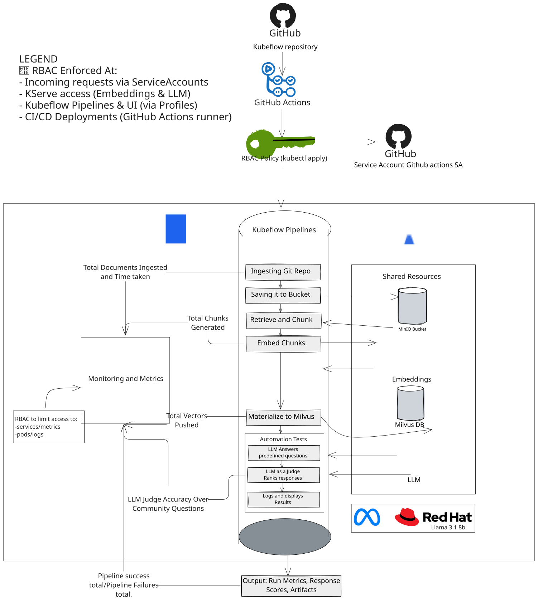
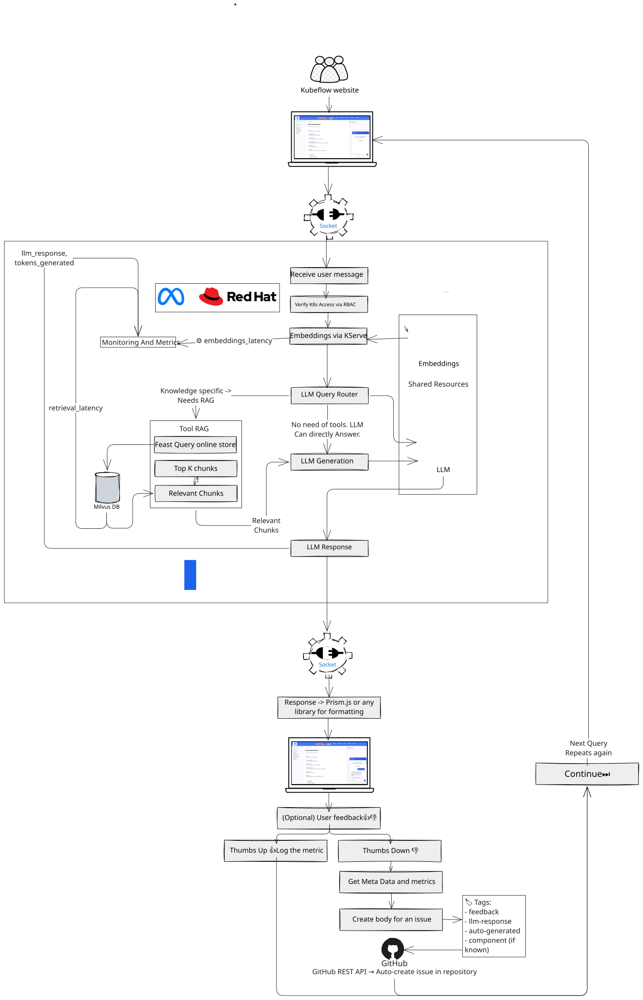

# Kubeflow Documentation AI Assistant (Flo)

**Author**: Santhosh Toorpu

[](https://github.com/kubeflow/community/issues/867)
[](LICENSE)
[](https://www.python.org/)
[](https://milvus.io/)
[](https://github.com/jlowin/fastmcp)
[](https://huggingface.co/google/gemma-4-E4B-it)

The official LLM implementation of the Kubeflow Documentation Assistant (**Flo / ARISE FLO**) powered by Retrieval-Augmented Generation (RAG) and the Model Context Protocol (MCP). This system provides an intelligent, contextual assistant for Kubeflow users to search across documentation, GitHub issues, and code manifests to get accurate, grounded answers to their questions.

<p align="center">
  
</p>

---

## Table of Contents

- [Overview](#overview)
  - [Why This Project Exists](#why-this-project-exists)
  - [Key Features](#key-features)
- [Architecture & Design](#architecture--design)
  - [High-Level Architecture](#high-level-architecture)
  - [RAG v4 & Intent Routing](#rag-v4--intent-routing)
  - [Two-Stage Retrieval: TEI Cross-Encoder Reranking & Sentence Compression](#two-stage-retrieval-tei-cross-encoder-reranking--sentence-compression)
- [Repository Layout](#repository-layout)
- [Model Serving Runtime (`llm-runtime`)](#model-serving-runtime-llm-runtime)
- [FastMCP Server & Available Tools](#fastmcp-server--available-tools)
- [RAG Ingestion Pipelines](#rag-ingestion-pipelines)
  - [Pipelines Overview](#pipelines-overview)
  - [In-Cluster TEI Embeddings Service](#in-cluster-tei-embeddings-service)
  - [Pipeline Details & Manifests](#pipeline-details--manifests)
- [Frontend Widget & Local Development](#frontend-widget--local-development)
  - [Chatbot Widget & User Feedback](#chatbot-widget--user-feedback)
  - [Local Mock Server for UI Testing](#local-mock-server-for-ui-testing)
- [Automated Nightly Feedback Triage](#automated-nightly-feedback-triage)
- [Observability & Tracing](#observability--tracing)
- [Evaluation & Testing](#evaluation--testing)
- [Prerequisites & Infrastructure Installation](#prerequisites--infrastructure-installation)
  - [Prerequisites](#prerequisites)
  - [Milvus Vector Database](#milvus-vector-database)
  - [Gateway Guardrails & Edge Security](#gateway-guardrails--edge-security)
- [Configuration](#configuration)
- [Troubleshooting](#troubleshooting)
- [Contributing](#contributing)
- [License & Acknowledgments](#license)
- [Modern Infrastructure & CI/CD (Kagent & MCP)](#modern-infrastructure--cicd-kagent--mcp)

---

## Overview

### Why This Project Exists

Kubeflow users often navigate an extensive ecosystem spanning multiple components, distributions, and repositories. Finding relevant configurations, version-specific installation instructions, or debugging active issues can be difficult with traditional keyword-based search. 

**Flo** addresses these challenges by combining:
- **Multi-Source RAG**: Unified retrieval across official documentation, GitHub issues/discussions, and Kubernetes component manifests.
- **Two-Stage Re-Ranking & Compression**: Candidate hits retrieved via hybrid vector + BM25 search are reranked with a dedicated cross-encoder and compressed to preserve high-density context within strict model limits.
- **Agentic Model Context Protocol (MCP)**: Deterministic intent routing and structured citations ensure answers are grounded without hallucinations.
- **Continuous Quality Feedback**: Built-in thumbs up/down user feedback in the chat widget connected to nightly triage jobs that categorize gaps using an LLM-as-a-judge.

### Key Features

- 🤖 **Production SLM Serving**: Powered by **Google's Gemma 4 E4B** (`google/gemma-4-E4B-it`) served via vLLM for high-throughput, low-latency contextual reasoning.
- 🔍 **3-Tool FastMCP Server**: Native FastMCP tools for searching documentation, GitHub issues, and code/manifests with parameter boundaries and metadata filters.
- ⚡ **RAG v4 Hybrid Retrieval**: Dense 768-d MPNet embeddings combined with native Milvus BM25 sparse search and typed `release_date` temporal routing.
- 🎯 **TEI Cross-Encoder Reranking**: In-cluster Text Embeddings Inference (TEI) reranking (`BAAI/bge-reranker-large`) for precision top-K scoring.
- ✂️ **Extractive Sentence Compression**: Token-aware lexical scoring that keeps sentences, lists, and markdown tables intact while eliminating irrelevant filler.
- 🔄 **Automated Kubeflow Pipelines**: Scheduled ingestion pipelines for docs, issues, code, and incremental updates calling an in-cluster TEI embedding service.
- 👍 **User Feedback & Triage**: Interactive thumbs up/down feedback widget logged to Langfuse, triaged nightly by a dedicated `flo-judge` model to identify content gaps.
- 📊 **Comprehensive Observability**: OpenTelemetry spans and Langfuse tracing across every tool execution, retrieval step, and embedding call.

---

## Architecture & Design

### High-Level Architecture



### Data Flow



### RAG v4 & Intent Routing

Production docs retrieval operates under the **RAG v4** data contract against Milvus (`kubeflow_docs` collection):
- **Embeddings**: 768-dimensional MPNet embeddings generated via Hugging Face Text Embeddings Inference (TEI).
- **Hybrid Retrieval**: Combines dense vector similarity with native BM25 sparse search.
- **Deterministic Intent Router (`SEARCH_MODE=auto`)**: Resolves user queries into specific retrieval modes (temporal/version queries route to BM25 with `release_date` sorting; conceptual queries use hybrid search with 0.3 dense / 0.7 sparse weights).
- **Structured Citations**: The model never prints raw URLs. Structured citation objects flow directly to the frontend widget to render clickable source pills.

Full architecture, eval numbers, and artifact trails: **[docs/RAG_V4_ARCHITECTURE.md](docs/RAG_V4_ARCHITECTURE.md)**.

### Two-Stage Retrieval: TEI Cross-Encoder Reranking & Sentence Compression

To optimize context precision and fit within token budgets, `search_kubeflow_docs` applies a two-stage retrieval pipeline:

1. **Candidate Retrieval**: Hybrid search retrieves the top candidates from Milvus.
2. **TEI Cross-Encoder Reranking**: Candidates are sent to the in-cluster TEI reranker service running `BAAI/bge-reranker-large` (`docs-agent-mcp/mcp-server/reranker_client.py`), which scores query-document pairs jointly.
3. **Extractive Context Compression**: The compressor (`docs-agent-mcp/mcp-server/compressor.py`) scores individual sentences lexically, allocates character budgets across ranked hits, and preserves markdown headers, code blocks, bullet lists, and tables within `DOCS_CONTEXT_MAX_CHARS` (default: 4000).

---

## Repository Layout

| Path | Purpose |
|------|---------|
| `docs-agent-mcp/` | FastMCP server, Kagent agent manifests, RAG pipelines, Helm charts, and Terraform platform stack |
| `docs-agent-mcp/charts/` | Production Helm charts: `docs-agent` (MCP + Kagent), `llm-runtime` (vLLM / Gemma 4), and `gateway-guardrails` |
| `docs-agent-mcp/pipelines/` | Kubeflow Pipelines: documentation, GitHub issues, code, and incremental ingestion |
| `docs-agent-mcp/session-issuer/` | FastAPI microservice issuing anonymous RS256 session JWTs for chat auth |
| `frontend/` | Docs site chatbot widget (`docs_scripts/chatbot.js`, `docs_styles/chatbot.css`) and local test harness (`demo/`) |
| `docs/agents/` | Issue triage documentation, area mappings (`area-map.json`), and triage labels |
| `tests/eval/` | Small Language Model (SLM) tool-use eval suite, Prompt Lab, and golden datasets |
| `deploy/` | Argo CD GitOps Application definitions, environment values (`prod`, `staging`), and promotion scripts |
| `legacy/` | Historical standalone FastAPI servers (`server/`, `server-https/`), older manifests, and Feast pipeline copies |
| `.github/workflows/` | CI/CD test workflows (`tests.yml`, `oke-cicd.yaml`) and pre-merge `/eval` workflows |

---

## Model Serving Runtime (`llm-runtime`)

The primary assistant is powered by **Google's Gemma 4 E4B** (`google/gemma-4-E4B-it`), served with vLLM v0.30.0 for high-performance inference, custom chat templating, and tool-calling support. A second GPU runtime is deployed as **`flo-judge`** (using Qwen2.5) for automated quality evaluations and nightly issue triage.

Model serving is managed declaratively via the `llm-runtime` Helm chart (`docs-agent-mcp/charts/llm-runtime/`).

<details>
<summary><b>View LLM Runtime Configuration & Values</b></summary>

```yaml
# docs-agent-mcp/charts/llm-runtime/values.yaml
model:
  name: "flo-llm"
  id: "google/gemma-4-E4B-it"
  maxModelLen: 32768
  gpuMemoryUtilization: 0.90
  tensorParallelSize: 1

resources:
  requests:
    cpu: "4"
    memory: "16Gi"
    nvidia.com/gpu: "1"
  limits:
    cpu: "8"
    memory: "32Gi"
    nvidia.com/gpu: "1"

vllm:
  image:
    repository: "vllm/vllm-openai"
    tag: "v0.30.0"
  extraArgs:
    - "--enable-auto-tool-choice"
    - "--tool-call-parser=gemma4"
```

*Note: Historical standalone KServe manifests for Llama 3.1-8B have been archived in [`legacy/manifests/`](legacy/manifests).*
</details>

---

## FastMCP Server & Available Tools

The MCP server is implemented with **FastMCP** (`docs-agent-mcp/mcp-server/server.py`) and exposes three production tools with bounded inputs, query normalization, and structured citations:

1. **`search_kubeflow_docs(query: str, top_k: int = 5)`**:
   - Searches official documentation in `kubeflow_docs`.
   - Automatically applies intent routing (`SEARCH_MODE=auto`), cross-encoder reranking, and extractive compression.
   - Emits structured citation metadata (`structured_content.citations`) and router provenance (`structured_content.retrieval`).

2. **`search_github_issues(query: str, top_k: int = 5, repo: str = "", state: str = "")`**:
   - Searches historical GitHub issues and discussion threads in `issues_rag`.
   - Supports safe filtering by repository (e.g., `kubeflow/manifests`, `kubeflow/pipelines`) and state (`open` or `closed`).

3. **`search_kubeflow_code(query: str, top_k: int = 5, resource_kind: str = "", repo: str = "")`**:
   - Searches repository code, component scripts, and Kubernetes YAML manifests in `code_rag`.
   - Supports filtering by Kubernetes `resource_kind` (e.g., `InferenceService`, `PipelineRun`, `ConfigMap`) and repository.

<details>
<summary><b>View Tool Definition Example & Arguments</b></summary>

```python
@mcp.tool()
@flo_tracing.traced("tool", inputs=("query", "top_k"))
def search_kubeflow_docs(query: str, top_k: int = 5) -> ToolResult:
    """Search Kubeflow documentation. Search mode is chosen here, not by the LLM."""
    query, top_k = _search_args(query, top_k)
    hits, retrieval_meta = search_docs_auto(query, top_k, DOCS_OUTPUT_FIELDS)
    hits = compressor.compress_hits(query, hits, DOCS_CONTEXT_MAX_CHARS)
    body, citations = format_docs_hits(hits)
    return search_tool_result(body, citations, retrieval=retrieval_meta)
```

The MCP server runs in-cluster and communicates with Kagent via the streaming Agent-to-Agent (A2A) protocol. Historical standalone REST/WebSocket servers are archived in [`legacy/server/`](legacy/server) and [`legacy/server-https/`](legacy/server-https).
</details>

---

## RAG Ingestion Pipelines

### Pipelines Overview

The ETL (Extract, Transform, Load) processes are implemented as Kubeflow Pipelines (`docs-agent-mcp/pipelines/`):

- **Documentation Ingestion (`kubeflow-pipeline.py`)**: Traverses documentation trees, parses Hugo/Markdown frontmatter, extracts release dates, splits into token-bounded chunks, embeds via TEI, and uploads into `kubeflow_docs`.
- **GitHub Issues Ingestion (`issues-pipeline.py`)**: Extracts issues, PR discussions, and comments with metadata (state, labels, author, reactions) into `issues_rag`.
- **Code & Manifest Ingestion (`code-pipeline.py`)**: Ingests repository files and YAML manifests, parsing Kubernetes resource kinds into `code_rag`.
- **Incremental Ingestion (`incremental-pipeline.py`)**: Synchronizes doc changes incrementally by comparing git commits and updating only modified files.

### In-Cluster TEI Embeddings Service

Instead of bundling heavy PyTorch libraries and sentence-transformers models inside the pipeline images:
- Pipeline components run as lightweight `python:3.11-slim` containers (`Dockerfile.pipeline`).
- Chunk embeddings are computed over HTTP via an in-cluster **Text Embeddings Inference (TEI)** service (`sentence-transformers/all-mpnet-base-v2` / `BAAI/bge-base-en-v1.5`).
- Embeddings and native BM25 text are written directly to Milvus via `pymilvus` (Feast has been removed).

<details>
<summary><b>View Pipeline Execution & Compilation</b></summary>

```bash
# Compile pipelines to YAML packages
cd docs-agent-mcp/pipelines
python3 kubeflow-pipeline.py   # outputs kubeflow_docs_rag_pipeline.yaml
python3 issues-pipeline.py     # outputs github_issues_rag_pipeline.yaml
python3 code-pipeline.py       # outputs code_rag_pipeline.yaml
python3 incremental-pipeline.py

# Submit a pipeline run directly to Kubeflow Pipelines
python3 submit_run.py \
  --pipeline-package kubeflow_docs_rag_pipeline.yaml \
  --run-name "manual-docs-ingest" \
  --experiment-name "docs-agent"
```
</details>

---

## Frontend Widget & Local Development

### Chatbot Widget & User Feedback

The documentation assistant UI (`frontend/docs_scripts/chatbot.js` and `frontend/docs_styles/chatbot.css`) is an interactive chat widget styled with Material 3 tokens:
- **Streaming Tokens**: Real-time markdown rendering and code syntax highlighting.
- **Structured Citations**: Clickable source pills displaying referenced doc titles, sections, and repository links.
- **Helpful / Unhelpful Feedback**: A "Helpful?" bar appears beneath completed turns. Users can submit thumbs up or down with optional feedback comments, which are sent to the gateway feedback service (`POST /api/feedback`) and recorded in Langfuse.

### Local Mock Server for UI Testing

Developers can test and iterate on the chatbot frontend locally without a Kubernetes cluster using the bundled mock server:

```bash
# Start the local mock server
python3 frontend/demo/mock_server.py
```
Open `http://localhost:8000/demo/index.html` in your browser. The mock server serves the frontend assets and simulates the streaming A2A agent protocol with canned markdown and code responses.

---

## Automated Nightly Feedback Triage

To ensure ongoing answer quality and identify documentation gaps:
- A nightly Kubernetes CronJob (`docs-agent-mcp/charts/docs-agent/templates/triage-cronjob.yaml`) runs daily at 03:00 UTC.
- The triage runner (`tests/feedback/triage.py`) pulls negative feedback scores (`user_feedback=false`) from Langfuse.
- Negative turns are probed with the live MCP server and evaluated by `flo-judge`.
- The evaluation classifies failures into categories (e.g., `content_gap`, `hallucination`, `retrieval_failure`) and generates a Markdown report attributing issues to the correct component repository using [`docs/agents/area-map.json`](docs/agents/area-map.json).

---

## Observability & Tracing

Full observability is built into the MCP server via `docs-agent-mcp/mcp-server/flo_tracing.py`:
- **Langfuse Integration**: Traces user sessions, MCP tool calls, Milvus search parameters, retrieval modes, and embedding generation spans.
- **OpenTelemetry**: OpenTelemetry spans are emitted and collected by the in-cluster collector (`deploy/platform/otel-collector/`).
- **Data Retention**: Automated CronJob (`deploy/platform/langfuse-retention/`) trims traces older than 4 weeks for production and 2 weeks for evaluations.

---

## Evaluation & Testing

Quality regression testing and model benchmarks are located under `tests/eval/`:

- **Small Model Tool-Use Evals (`tests/eval/slm_tool_eval.py`)**: Tests candidate models across 97 test cases (x3 repeats) for tool schema adherence, streaming latency, and argument formatting. See [tests/eval/SLM_EVALS.md](tests/eval/SLM_EVALS.md).
- **Prompt Lab (`tests/eval/prompt_lab.py`)**: Live harness to evaluate prompt variations against retrieval accuracy and defining terms.
- **Showcase Evals (`tests/eval/run_showcase_eval.py`)**: Evaluates core regression queries defined in `tests/eval/queries.json`.

Run unit and integration tests locally:
```bash
pytest
```

---

## Prerequisites & Infrastructure Installation

### Prerequisites

- Kubernetes cluster (1.28+)
- Helm 3.x
- Kubeflow Pipelines v2
- GPU nodes (`nvidia.com/gpu >= 1` for LLM inference)

### Milvus Vector Database

<details>
<summary><b>View Milvus Helm Deployment Steps</b></summary>

1. **Add Helm Repository**:
   ```bash
   helm repo add milvus https://milvus-io.github.io/milvus-helm/
   helm repo update
   ```

2. **Install Milvus Standalone**:
   ```bash
   helm upgrade --install my-release zilliztech/milvus -n docs-agent \
     --set cluster.enabled=false \
     --set standalone.enabled=true \
     --set etcd.replicaCount=1 \
     --set etcd.persistence.enabled=false \
     --set minio.mode=standalone \
     --set minio.replicas=1 \
     --set pulsar.enabled=false \
     --set pulsarv3.enabled=false \
     --set standalone.podAnnotations."sidecar\.istio\.io/inject"="false"
   ```

3. **Configure KFP Access RBAC**:
   ```bash
   kubectl create role milvus-access \
     --namespace docs-agent \
     --verb=get,list,watch \
     --resource=services,endpoints

   kubectl create rolebinding kfp-to-milvus-editor \
     --namespace docs-agent \
     --role=milvus-access \
     --serviceaccount=kubeflow:default-editor
   ```
</details>

### Gateway Guardrails & Edge Security

The edge gateway is deployed via the `gateway-guardrails` Helm chart (`docs-agent-mcp/charts/gateway-guardrails/`):
- **Rate Limiting**: 60 req/min global token bucket on the public HTTPS listener.
- **CORS Lockdown**: Restricts chat requests to verified documentation domains.
- **Session Auth**: Integrates with `session-issuer` to enforce anonymous JWT verification on `/a2a/*` and `/api/feedback`.

---

## Configuration

### MCP Server Environment Variables

| Variable | Default | Description |
|---|---|---|
| `PORT` | `8000` | FastMCP server port |
| `MAX_QUERY_CHARS` | `512` | Max allowed character limit per query |
| `MAX_TOP_K` | `20` | Upper bound for top_k parameter |
| `DOCS_CONTEXT_MAX_CHARS` | `4000` | Character budget for compressed docs context |
| `SEARCH_MODE` | `auto` | Retrieval mode (`auto`, `hybrid`, `bm25`, `dense`) |
| `COLLECTION_NAME` | `kubeflow_docs` | Milvus docs collection name |
| `ISSUES_COLLECTION_NAME` | `issues_rag` | Milvus issues collection name |
| `CODE_COLLECTION_NAME` | `code_rag` | Milvus code collection name |
| `MILVUS_HOST` | `milvus.docs-agent.svc.cluster.local` | Milvus service hostname |
| `MILVUS_PORT` | `19530` | Milvus service port |
| `TEI_EMBEDDINGS_URL` | `http://tei-embeddings.ml-infra:80` | In-cluster TEI embeddings endpoint |
| `TEI_RERANKER_URL` | `http://tei-reranker.ml-infra:80` | In-cluster TEI cross-encoder endpoint |

---

## Troubleshooting

<details>
<summary><b>View Common Issues & Debug Commands</b></summary>

### Common Diagnostic Checks

1. **Verify Milvus Status**:
   ```bash
   kubectl get pods -n docs-agent -l app.kubernetes.io/name=milvus
   ```

2. **Verify TEI Embeddings & Reranker**:
   ```bash
   kubectl get pods -n ml-infra -l app=tei-embeddings
   kubectl logs -n ml-infra deployment/tei-reranker --tail=50
   ```

3. **Check MCP Server Logs**:
   ```bash
   kubectl logs -n docs-agent deployment/mcp-kubeflow-docs -c mcp-server --tail=100
   ```

4. **Test Milvus Connection via Python**:
   ```python
   from pymilvus import connections
   connections.connect("default", host="milvus.docs-agent.svc.cluster.local", port="19530")
   print("Connected successfully!")
   ```
</details>

---

## Contributing

We welcome contributions! Please see our [Contributing Guidelines](CONTRIBUTING.md) for details.

1. Fork the repository
2. Create a feature branch (`git checkout -b feature/amazing-feature`)
3. Commit your changes (`git commit -m 'feat: add some feature'`)
4. Push to the branch (`git push origin feature/amazing-feature`)
5. Open a Pull Request

---

## License

This project is licensed under the Apache License 2.0 - see the [LICENSE](LICENSE) file for details.

## Acknowledgments

### Mentors
- [Francisco Javier Arceo](https://www.linkedin.com/in/franciscojavierarceo/) - Project mentor and guidance
- [Chase Christensen](https://www.linkedin.com/in/chase-c-695463162/) - Project mentor and technical support

### Organizations
- [Google Summer of Code (GSoC)](https://summerofcode.withgoogle.com/) for providing this incredible opportunity
- [Red Hat AI](https://www.redhat.com/en/topics/ai) for initial model serving support
- [Hugging Face](https://huggingface.co/) for model hosting and TEI inference engines
- [Oracle Cloud Infrastructure (OCI)](https://www.oracle.com/cloud/) for providing cloud resources and infrastructure

### Open Source Community
- [Kubeflow Community](https://github.com/kubeflow/community) for the KEP-867 proposal
- [Milvus](https://milvus.io/) for high-performance vector search
- [vLLM](https://github.com/vllm-project/vllm) for high-performance LLM serving
- [FastMCP](https://github.com/jlowin/fastmcp) for standard agentic tool integration

---

## Modern Infrastructure & CI/CD (Kagent & MCP)

The project has evolved to utilize the Model Context Protocol (MCP) and **kagent** to route queries intelligently. The infrastructure is heavily automated using Terraform and GitHub Actions.

### Terraform (`docs-agent-mcp/terraform/`)
We use Terraform for declarative, reproducible cluster infrastructure on OKE.
*   **`variables.tf`**: Single source of truth for component versions (Knative, Istio, KServe, etc.) and namespace names.
*   **`namespaces.tf`**: Manages the `ml-infra` and `docs-agent` namespaces.
*   **`knative.tf`**: Installs `cert-manager`, Knative Serving (Core & CRDs), Istio base/istiod, and KServe, applying crucial ConfigMap patches for scheduling.
*   **`kubeflow_pipelines.tf`**: Deploys Kubeflow Pipelines (Standalone) into the `kubeflow` namespace without Istio sidecars (to prevent routing conflicts), persisting `fsGroup` patches for SeaweedFS.
*   **`milvus.tf`**: Uses the Milvus Operator to deploy a lightweight Milvus Standalone instance strictly scheduled on CPU nodes, reserving GPU nodes purely for LLM inference.
*   **`kagent.tf`**: Installs official `kagent-crds` and the `kagent` controller via OCI Helm charts, with bundled agents cleanly disabled.
*   **`gateway_guardrails.tf`**: Installs the local `charts/gateway-guardrails` Helm chart — the single source of truth for the public edge: Istio Gateway + TLS, CORS-locked VirtualService, rate limits, and the zero-trust AuthorizationPolicies that explicitly allow internal cluster traffic where needed (e.g., KFP Pipeline to Milvus, Kagent to Milvus). Replaces the former inline `istio_policies.tf` / `kagent_ingress.tf`.

### Gateway Guardrails Helm Chart (`docs-agent-mcp/charts/gateway-guardrails/`)
Guardrails protecting the publicly shared chatbot, all tunable via `values.yaml`:
*   **Rate limiting**: 60 req/min global token bucket on the chatbot HTTPS listener (EnvoyFilter), plus an optional per-client-IP layer (Envoy ratelimit service + Redis, off until the ingress preserves client IPs).
*   **CORS lockdown**: only the published widget origin may embed the chatbot; a 30s route timeout caps hung LLM calls.
*   **Mesh policies**: the RAG-stack AuthorizationPolicies (Milvus, LLM, MCP, embeddings), previously raw YAML heredocs inside Terraform.

### Pipeline Optimizations (`docs-agent-mcp/pipelines/`)
The ingestion pipeline was rewritten to maximize efficiency and avoid Kubernetes ephemeral storage eviction:
*   **Feast Removal**: The pipeline now writes embeddings directly to Milvus using `pymilvus`, dramatically lowering complexity.
*   **TEI Embeddings**: Chunking components call the in-cluster TEI embeddings service over HTTP instead of loading a model in-process, so `Dockerfile.pipeline` stays a plain `python:3.11-slim` image with no PyTorch/model weights baked in — avoiding both the OKE pod eviction and Hugging Face rate-limit issues without the multi-GB image.

### GitHub Actions CI/CD (`.github/workflows/`)
| Workflow | When it runs | Purpose |
|----------|----------------|---------|
| **`oke-cicd.yaml`** | Every PR and push to `main` | Compile pipelines, ruff, pytest; build/push MCP image to GHCR and optional OKE deploy when repo var `ENABLE_OKE_DEPLOY=true` |
| **`tests.yml`** | Every PR and push to `main` | Ruff lint/format + pytest (no cluster) |

Operator forks set `ENABLE_OKE_DEPLOY=true` and configure the `kubeflow` GitHub Environment (OCI secrets) for cluster deploy and `smoke_tools.py` validation. GHCR push uses the built-in `GITHUB_TOKEN`; optional `GHCR_TOKEN` / `GHCR_USERNAME` are only needed if the package is private.
